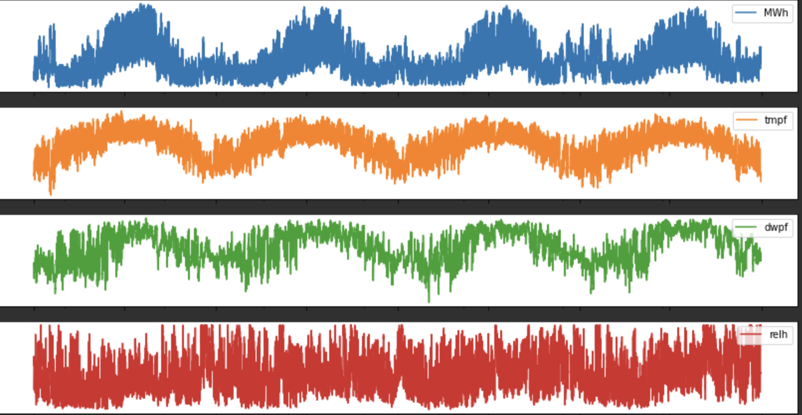

# Predictive power consumption based on recurrent neural networks (Python code implementation)

Predicting Electricity Consumption with More Accurate Results Based on Recurrent Neural Networks (Python Code Implementation)

## Images

<!-- PAYMENT_BLOCK -->

## Get this dataset

- Payment link (Stripe): [Buy now](https://buy.stripe.com/3cs8yP7sY87d0vu9AB)
- Payment QR code: 

<!-- /PAYMENT_BLOCK -->
